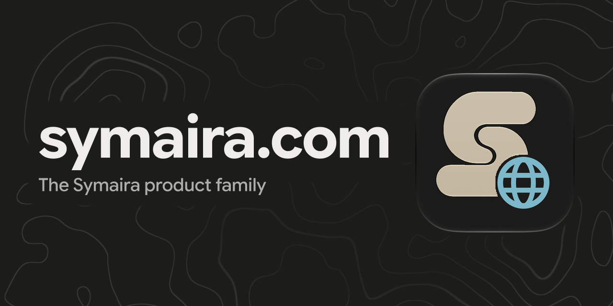

# symaira.com

> **Current product state — source/consumer cutover completed 2026-09-13:** Desktop and Brain are the primary products; Cockpit, EraseMe and Fritz are specialized products. Browse, Operate and Scope are optional Brain modules. Their sources and direct consumers are cut over, Browse's former repository is archived, and Cockpit is tune-only. No signed Brain-module release or package-manager migration has been published. See [PB-2026-09-09](docs/product-boundaries.md).

[](https://github.com/danieljustus/symaira.com/actions/workflows/ci.yml)
[](https://github.com/danieljustus/symaira.com/releases/latest)



Public website for the Symaira ecosystem.

Symaira tools follow one product model: free, open-source, self-hosted cores.
There are no paid or cloud-hosted editions — each tool ships exactly once.

## Current Public Story

The site presents product and module pages for Credential Vault (`symvault`),
Brain, Desktop, Browse, EraseMe, Cockpit and Fritz (see `src/config/products.tsx` and the route table
in `src/App.tsx`). Browse is an optional Brain module, not an additional
independent product repository.

The absorbed tools no longer have their own pages or routes: Memory, Skills and
Guard live inside Brain; Seek, Print, Ingest, Meet, Relate and Room inside
Desktop; Fetch inside Brain's Browse module; Operate and Scope inside Brain;
hardware/system tuning inside Cockpit. Their capabilities are described as
features of the owning product. Source ownership does not establish a new
signed release or package-manager replacement.

## Documentation

- [Repository ownership](docs/repositories.md): products, libraries and distribution.
- [Product and execution boundaries](docs/product-boundaries.md): the versioned PB-2026-09-09 contract.

## Development

```bash
npm install
npm run dev
npm run build
```

## Stack

- React
- TypeScript
- Vite
- Liquid Topography design source vendored from `symaira-appkit` (tokens, WebGL2 topography, Google Sans Flex font, line icons); see [`src/liquid-topography/README.md`](src/liquid-topography/README.md)

## Ecosystem Rule

Do not advertise separate Pro or cloud-hosted editions. Product availability
and install guidance must follow actual published release artifacts, not
source consolidation or a development branch.
